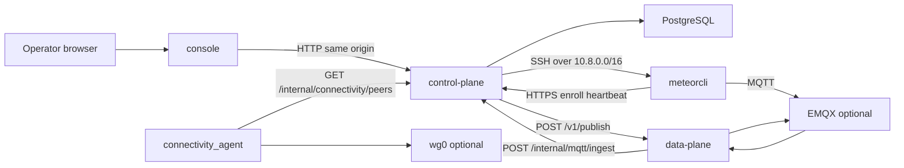

# Architecture

MeteorCloud is modular. Planes do not import each other’s internals; they talk over HTTP, MQTT, and configuration. Product-level overview: [Concepts](concepts.md). Agent and contributor rules: [AGENTS.md](../AGENTS.md), [CONTRIBUTING.md](../CONTRIBUTING.md).

## What is (and is not) split

| Kind | What | In this product |
| --- | --- | --- |
| **Git repository** | Where source is edited | One repo (`meteor-cloud`) |
| **Code / module** | Folders and packages | `console/`, `src/control-plane/` (`app`), `src/data-plane/` (`data_plane`), `src/device-plane/agent/` (`meteorcli`, `edge_agent`), `src/device-plane/gateway/`, `src/device-plane/runtime/` |
| **Deployable service** | What Compose/Helm start | API, console, optional data-plane + EMQX, optional VPN on the **host** |
| **Published artifact** | What a machine downloads | Container images; intended `meteorcli` GitHub Release tarball (not built yet) |

VPN, MQTT, Redis, and MinIO are **optional**. They are off unless that install enables them. Device types in the API are catalog rows ([Device types](fleet/device-types.md)), not extra code trees.

## Rules

1. The control plane remains Python.
2. Data-plane and device-plane implementations may use other languages later. No language migration is in progress.
3. Planes must not import one another’s private Python packages (`app`, `data_plane`, `edge_agent`, `meteorcli`).
4. Cross-plane traffic uses documented HTTP/MQTT contracts ([`contracts/mqtt-http.md`](../contracts/mqtt-http.md), control-plane `/internal/*`).
5. PostgreSQL is the control-plane database. Other stores stay behind existing ports.
6. Deployment infrastructure stays under `deploy/` and `infrastructure/`, not domain modules.
7. VPN is an optional deploy capability (Compose + Ansible). It is not a reason to split the repo.
8. The console keeps same-origin API access in production (`window.location.origin`). Locally it uses `VITE_API_BASE_URL`.
9. The device agent must be installable without cloning this repository. **Today** `installcli.sh` still `pip install`s the agent directory and needs sibling `src/device-plane/runtime/`. A GitHub Release tarball is the target; it is not implemented.
10. Device types are configuration, not automatically separate codebases.

`make check-plane-imports` enforces rule 3 on `src/`.

## Request and data flows



The WireGuard gateway and browser SSH exist only when VPN / `SHELL_PROVIDER=ssh_gateway` is on. MQTT and the data plane exist only when MQTT is enabled.

## Three planes

| Plane | Deployable unit | Compose |
| --- | --- | --- |
| Control plane | Identity, tenancy, devices, audit, MQTT policy, ingest, operator API | `deploy/compose/control-plane.yml` |
| Data plane | EMQX client, publish/watch, ingest forward | `deploy/compose/data-plane.yml` |
| Device plane | `meteorcli` on the edge device | not a Compose service |

Operator **console**: Vite/React in `console/` — browser → control-plane API only. See [Console](console.md).

**Gateway** (host, not a container): [`src/device-plane/gateway/connectivity_agent.py`](../src/device-plane/gateway/connectivity_agent.py) polls `/internal/connectivity/peers` with `CONNECTIVITY_INTERNAL_TOKEN` and applies `wg set`. Device WireGuard private keys never leave the device.

```text
┌─────────────────┐     ┌─────────────────┐     ┌──────────────────────┐
│  Device plane   │     │   Data plane    │     │   Control plane      │
│  (meteorcli)    │     │  (MQTT gateway) │     │  (API + Postgres)    │
└────────┬────────┘     └────────┬────────┘     └──────────┬───────────┘
         │                       │                         │
         │  HTTPS enroll /       │                         │
         │  heartbeat            ├────────────────────────►│
         │────────────────────────────────────────────────►│
         │                       │                         │
         │  MQTT ──► EMQX ──────►│  HTTP ingest ──────────►│
         │◄── commands ◄─ EMQX ◄─│◄── HTTP publish ────────│
```

## Deployment paths

Same images and settings, two installers:

| Path | Where | Files |
|------|-------|-------|
| Docker Compose + Ansible | One VM, EC2, or on-prem server | `deploy/compose/`, `deploy/ansible/` |
| Kubernetes + Helm | An existing cluster (MeteorCloud does not provision clusters) | `deploy/kubernetes/helm/meteorcloud/` |

On a VM you already have, `make up` runs the Ansible path on that host. To create a new AWS EC2, `edge-installer` / `make aws-up` runs Terraform then the same Ansible path. See [Deployment](deployment.md), [Kubernetes](kubernetes.md), and [Services](services.md).

## Control plane

```text
src/control-plane/app/
├── api/rest/         # health
├── ports/            # MQTTGateway, RateLimiter, connectivity, shell, storage
├── adapters/         # data-plane HTTP, redis/memory, s3/filesystem, ota=none
├── identity/
├── tenancy/
├── devices/
├── audit/
├── mqtt/             # ACL, credentials, ingest, SSE hub
├── core/
└── main.py
```

PostgreSQL is the control-plane database. Vendor systems (EMQX, Redis, future OTA) sit behind ports — no generic `DatabaseProvider`.

## Data plane

Python FastAPI process. Owns the platform MQTT session. Forwards each inbound payload to `POST {CONTROL_PLANE_URL}/internal/mqtt/ingest`. Contract: [`contracts/mqtt-http.md`](../contracts/mqtt-http.md).

Keep **one** data-plane MQTT subscriber until shared subscriptions exist.

## Device agent (`meteorcli`)

Source: [`src/device-plane/agent/`](../src/device-plane/agent/). Runtime adapters (systemd, docker, compose) live in sibling [`src/device-plane/runtime/`](../src/device-plane/runtime/) and are force-included in the wheel.

**Today:** `./installcli.sh` from that directory (`pip install` of the local tree). A device that only wants the agent still needs those two directories.

**Target (not implemented):** GitHub Release tag `agent-v*`, assets `meteorcli-<version>.tar.gz` (agent + `runtime` + `installcli.sh` only, no secrets) and `install-meteorcli.sh`. Devices `curl` the installer and never clone this repo. Remaining work: pack script (`make agent-dist`), remote install mode, CI release on tag, console/docs one-liner. Version is the agent `pyproject.toml` version. Integrity verification (checksums) is not implemented.

## Provider selection

| Port | Implemented | Reserved (fail fast) |
|------|-------------|----------------------|
| Persistence | PostgreSQL | — |
| `RateLimiter` | `redis`, `memory` | — |
| `MQTTGateway` | Data-plane HTTP → EMQX | other broker names |
| Telemetry last-value | PostgreSQL columns on `Device` | `timescale`, `clickhouse` |
| `OTAProvider` | `none` | `mender` and others later |
| `DeviceConnectivityProvider` | `wireguard`, `none` | other tunnels later |
| `DeviceShellProvider` | `ssh_gateway`, `echo` (tests), `none` | MQTT PTY later |
| `ObjectStorage` | `s3`, `filesystem` | — |

Artifact binaries live in object storage; PostgreSQL keeps metadata and `storage_key`. See [Artifacts](fleet/artifacts.md).

## Kubernetes

The Helm chart deploys `backend`, `console`, and (with MQTT) `data-plane` and EMQX as separate Deployments. API and console scale independently; the data-plane MQTT consumer stays at 1 replica until shared subscriptions exist. See [Kubernetes](kubernetes.md).
